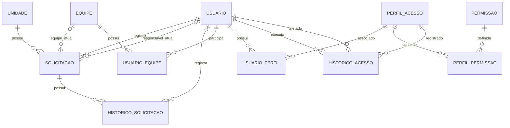

# 04. Modelagem de Dados | Gestão de Solicitações de Manutenção

## 1. Objetivo

Apresentar uma proposta conceitual e lógica de dados para sustentar o MVP de gestão de solicitações de manutenção da Vértice.

O modelo considera o registro das solicitações, a identificação dos envolvidos, a classificação e o direcionamento do atendimento, as mudanças de status e a conclusão do serviço.

A estrutura é uma proposta inicial. A necessidade de entidades adicionais, como ativos, locais detalhados, anexos e materiais utilizados, dependerá das validações com o Product Owner.

## 2. Entidades propostas

### 2.1. Usuario

Representa os funcionários e demais usuários autorizados a interagir com o sistema.

**Atributos:**

- `id_usuario`: identificador único do usuário (PK).
- `nome`: nome do usuário.
- `email`: endereço de e-mail ou identificador de acesso.
- `ativo`: indica se o usuário está ativo.
- `data_criacao`: data de criação do registro.

**Justificativa:** permite identificar o solicitante, os responsáveis pela triagem, os responsáveis pelo atendimento e os autores das movimentações.

Os perfis e as permissões deverão ser definidos com o Product Owner. Caso o projeto exija múltiplos papéis por usuário, recomenda-se uma estrutura específica de perfis e permissões, em vez de concentrar todas as regras em um único campo.

### 2.2. Unidade

Representa uma unidade administrativa ou operacional da Vértice.

**Atributos:**

- `id_unidade`: identificador único da unidade (PK).
- `nome`: nome da unidade.
- `descricao`: descrição opcional.
- `ativa`: indica se a unidade está ativa.

**Justificativa:** permite associar as solicitações à unidade em que a necessidade foi identificada e viabiliza consultas gerenciais por unidade.

### 2.3. Solicitacao

Representa a demanda de manutenção registrada no sistema.

**Atributos:**

- `id_solicitacao`: identificador único da solicitação (PK).
- `id_solicitante`: referência ao usuário que abriu a solicitação (FK).
- `id_unidade`: referência à unidade relacionada (FK).
- `id_responsavel_atual`: referência opcional ao usuário atualmente responsável (FK).
- `id_equipe_atual`: referência opcional à equipe atualmente responsável (FK).
- `titulo`: resumo da solicitação.
- `descricao`: detalhamento do problema.
- `local_afetado`: informação textual inicial sobre o local ou item afetado.
- `categoria`: classificação da manutenção.
- `prioridade`: nível de prioridade atribuído.
- `status_atual`: situação atual da solicitação.
- `data_abertura`: data e hora do registro.
- `data_conclusao`: data e hora da conclusão, quando aplicável.
- `solucao_aplicada`: descrição do serviço realizado ou da solução aplicada, quando concluída.

**Justificativa:** concentra os dados necessários para acompanhar a solicitação durante seu ciclo de vida.

A categoria e a prioridade são apresentadas como atributos conceituais. Caso precisem ser administradas em cadastros próprios, poderão ser normalizadas em entidades como `CategoriaManutencao` e `Prioridade`.

### 2.4. Equipe

Representa uma equipe responsável por executar ou coordenar os atendimentos.

**Atributos:**

- `id_equipe`: identificador único da equipe (PK).
- `nome`: nome da equipe.
- `descricao`: descrição opcional.
- `ativa`: indica se a equipe está ativa.

**Justificativa:** permite direcionar solicitações para uma equipe, sem depender exclusivamente da atribuição individual.

A existência de equipes e a forma como serão organizadas precisam ser validadas com o Product Owner.

### 2.5. HistoricoSolicitacao

Registra as movimentações relevantes de uma solicitação ao longo do processo.

**Atributos:**

- `id_historico`: identificador único da movimentação (PK).
- `id_solicitacao`: referência à solicitação (FK).
- `id_usuario`: referência ao usuário que realizou a ação (FK).
- `tipo_evento`: tipo de movimentação registrada.
- `status_anterior`: status anterior, quando aplicável.
- `status_novo`: novo status, quando aplicável.
- `descricao`: observação ou justificativa da movimentação.
- `data_evento`: data e hora do registro.

**Justificativa:** mantém a rastreabilidade das mudanças de status, complementações, atribuições e conclusão. O histórico permite compreender o que ocorreu sem depender apenas do estado atual da solicitação.

### 2.6. Relacionamento UsuarioEquipe

Representa a associação entre usuários e equipes, caso um usuário possa pertencer a uma ou mais equipes.

**Atributos:**

- `id_usuario`: referência ao usuário (PK composta e FK).
- `id_equipe`: referência à equipe (PK composta e FK).
- `data_vinculo`: data do vínculo.
- `ativo`: indica se o vínculo está ativo.

**Justificativa:** evita duplicar os dados do usuário e da equipe e permite representar uma relação muitos-para-muitos.

Caso a Vértice utilize apenas uma equipe por usuário, esse relacionamento poderá ser simplificado após a validação do cenário real.

### 2.7. PerfilAcesso

Representa um conjunto de permissões que pode ser associado a usuários.

**Atributos:**

- `id_perfil`: identificador único do perfil (PK).
- `nome`: nome do perfil.
- `descricao`: finalidade do perfil.
- `ativo`: indica se o perfil pode ser associado a usuários.

**Justificativa:** permite organizar as permissões por função e evitar a configuração individual de cada ação para cada usuário.

### 2.8. Permissao

Representa uma ação que pode ser autorizada no sistema.

**Atributos:**

- `id_permissao`: identificador único da permissão (PK).
- `codigo`: código único da ação protegida.
- `descricao`: descrição da ação autorizada.

**Exemplos de códigos propostos:** `solicitacao.registrar`, `solicitacao.consultar`, `solicitacao.triar`, `solicitacao.atribuir`, `atendimento.atualizar`, `solicitacao.concluir`, `historico.consultar` e `acesso.perfis.gerenciar`.

A lista definitiva de permissões deverá ser validada com o PO.

### 2.9. UsuarioPerfil

Representa a associação entre usuários e perfis de acesso.

**Atributos:**

- `id_usuario`: referência ao usuário (PK composta e FK).
- `id_perfil`: referência ao perfil (PK composta e FK).
- `data_vinculo`: data e hora da associação.
- `ativo`: indica se a associação está vigente.

**Justificativa:** permite que um usuário possua um ou mais perfis, caso essa possibilidade seja aprovada pelo PO.

### 2.10. PerfilPermissao

Representa as permissões concedidas a cada perfil.

**Atributos:**

- `id_perfil`: referência ao perfil (PK composta e FK).
- `id_permissao`: referência à permissão (PK composta e FK).

**Justificativa:** permite definir quais ações cada perfil pode executar sem duplicar permissões em diferentes registros de usuários.

### 2.11. HistoricoAcesso

Registra alterações administrativas nos perfis e nas permissões associadas aos usuários.

**Atributos:**

- `id_evento_acesso`: identificador único do evento (PK).
- `id_usuario_executor`: referência ao usuário que realizou a alteração (FK).
- `id_usuario_afetado`: referência ao usuário cuja associação foi alterada (FK).
- `id_perfil`: referência ao perfil envolvido na alteração (FK).
- `tipo_evento`: identifica a ação realizada, como associação ou remoção de perfil.
- `data_evento`: data e hora da alteração.
- `descricao`: detalhe complementar do evento, quando necessário.

**Justificativa:** permite rastrear alterações de acesso e identificar quem realizou a ação, qual usuário foi afetado e quando ela ocorreu.

## 3. Relacionamentos e cardinalidades

- **Usuario 1:N Solicitacao:** um usuário pode registrar várias solicitações; cada solicitação possui um solicitante.
- **Unidade 1:N Solicitacao:** uma unidade pode possuir várias solicitações; cada solicitação está vinculada a uma unidade.
- **Usuario 1:N Solicitacao:** um usuário pode ser responsável por várias solicitações; uma solicitação pode ter um responsável individual atual, se essa modalidade de atribuição for utilizada.
- **Equipe 1:N Solicitacao:** uma equipe pode responder por várias solicitações; uma solicitação pode estar vinculada a uma equipe atual.
- **Solicitacao 1:N HistoricoSolicitacao:** uma solicitação pode possuir várias movimentações; cada movimentação pertence a uma solicitação.
- **Usuario 1:N HistoricoSolicitacao:** um usuário pode registrar várias movimentações; cada movimentação identifica seu autor quando aplicável.
- **Usuario N:M Equipe:** um usuário pode pertencer a várias equipes e uma equipe pode ter vários usuários, por meio de `Relacionamento UsuarioEquipe`.
- **Usuario N:M PerfilAcesso:** um usuário pode possuir vários perfis, e um perfil pode estar associado a vários usuários, por meio de `UsuarioPerfil`.
- **PerfilAcesso N:M Permissao:** um perfil pode possuir várias permissões, e uma permissão pode pertencer a vários perfis, por meio de `PerfilPermissao`.
- **Usuario 1:N HistoricoAcesso:** um usuário pode executar várias alterações administrativas de acesso.
- **Usuario 1:N HistoricoAcesso:** um usuário pode ser afetado por várias alterações de acesso.
- **PerfilAcesso 1:N HistoricoAcesso:** um perfil pode aparecer em vários eventos de alteração de acesso.

As chaves estrangeiras de responsável e equipe são opcionais enquanto a solicitação não tiver sido atribuída. As regras para exigir uma atribuição devem ser definidas conforme as transições de status.

## 4. Diagrama conceitual em Mermaid

O GitHub pode renderizar o diagrama abaixo diretamente no arquivo Markdown. Ele representa as principais entidades e seus relacionamentos.

O diagrama apresenta os relacionamentos principais, sem detalhar graficamente todos os atributos. A descrição das entidades e dos atributos acima complementa a representação.

## 5. Regras de integridade e decisões de modelagem

### Identificação única

Cada solicitação deve possuir identificador único. A identificação não deve depender apenas do nome do solicitante ou da descrição do problema.

### Integridade referencial

A solicitação deve referenciar um usuário solicitante e uma unidade válidos. As atribuições devem referenciar usuários e equipes existentes, conforme a regra adotada.

### Histórico de movimentações

As movimentações devem ser armazenadas como registros próprios, associados à solicitação. Atualizar o status atual não deve apagar as movimentações anteriores.

### Status atual e histórico

O status atual permanece em `Solicitacao` para facilitar consultas e filtros. As transições são registradas em `HistoricoSolicitacao` para manter a rastreabilidade.

Essa duplicidade controlada de informação é intencional: o status atual representa a situação vigente, enquanto o histórico registra a sequência de eventos.

### Responsabilidade atual e anterior

Os campos de responsável e equipe na entidade `Solicitacao` representam a atribuição atual. As mudanças de atribuição devem ser preservadas no histórico.

Se for necessário consultar detalhadamente todos os períodos de atribuição, poderá ser criada uma entidade específica de atribuição em uma evolução do modelo.

### Exclusão e retenção

Solicitações com histórico não devem ter seus registros removidos indiscriminadamente. As regras de exclusão, arquivamento e retenção devem considerar auditoria, privacidade e políticas internas da empresa.

## 6. Aspectos a validar antes da implementação

- Necessidade de cadastro detalhado de locais e equipamentos.
- Necessidade de anexos, fotografias ou documentos.
- Necessidade de tabelas específicas para categorias e prioridades.
- Necessidade de múltiplos responsáveis ou equipes por solicitação.
- Necessidade de manter histórico detalhado de atribuições.
- Regras de retenção, auditoria e exclusão.
- Perfis de acesso e permissões.
- Necessidade de integração com cadastros corporativos existentes.
- Definição da matriz de permissões por perfil e das restrições de acesso por unidade.
- Definição da possibilidade de múltiplos perfis por usuário.
- Definição dos responsáveis pela administração dos perfis.
- Política de auditoria e retenção dos registros de alterações de acesso.

## 7. Consistência com os demais artefatos

O modelo suporta as histórias de registro, consulta, triagem, direcionamento, atendimento, conclusão e histórico descritas em [02-backlog-mvp.md](02-backlog-mvp.md).

Os principais pontos ainda sujeitos a decisão estão descritos em [03-validacoes-product-owner.md](03-validacoes-product-owner.md). O fluxo de utilização dessas entidades está representado em [01-processo-bpmn.md](01-processo-bpmn.md).
